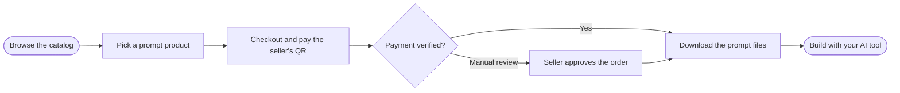

  

   
   

  # Althentic.dev

  **Marketplace for AI-ready prompts.**
  Build websites, research, and more, using prompts that actually deliver what you expect.

   

  
  
  
  

   

  
  
  
  
  

  [Website](https://althentic.vercel.app/) · [Documentation](https://althentic.github.io/docs) · [Contact](mailto:althentic.dev@gmail.com)

 

## About

Anyone can ask an AI to build something today. Few can write a prompt that gets the result they actually imagined.

**Althentic.dev** is a multi-tenant marketplace where creators sell ready-to-use prompts (for websites, research, learning, or anything AI can generate), and buyers get results that match expectations, not guesswork.

We don't sell the finished output. We sell the *recipe*.

<table>
<tr>
<td width="33%" valign="top">

### 🏪 Open a Storefront
Every seller gets their own shop with a unique slug, with no middleman holding your money.

</td>
<td width="33%" valign="top">

### 📦 Prompt-First Products
Each listing ships with the prompt, optional templates, and a preview, built for clarity, not surprises.

</td>
<td width="33%" valign="top">

### ✅ Verified Before It's Live
Every product passes an inspection step (automated checks plus human review) before buyers ever see it.

</td>
</tr>
</table>

 

## How It Works

No black-box output. You get the exact prompt, run it with the AI tool of your choice, and own the result end to end.

 

## What You'll Find Here

| | |
|---|---|
| 🛠️ | Open-source tooling and utilities that power the Althentic.dev platform |
| 📖 | Documentation and guides for buyers and sellers |
| 🤝 | Community health files for contributors |

 

## Organization Activity

 

 

  

 

## Repositories

| Repository | Description |
|---|---|
| [**Althentic**](https://github.com/Althentic-dev/Althentic) | Main platform: Next.js full-stack marketplace |

 

## Get in Touch

---

  © 2026 Althentic.dev. All rights reserved.

